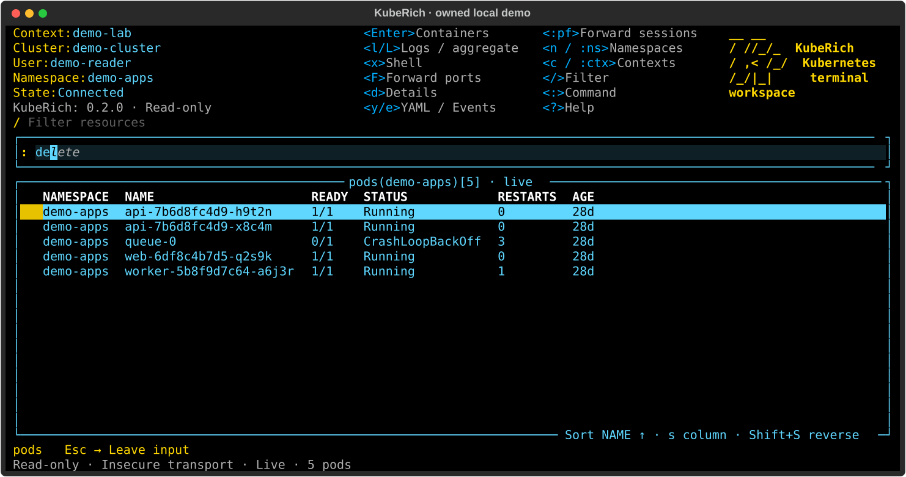

# KubeRich

Browse Kubernetes resources, read logs and manage workloads from your terminal.

Latest published version: [GitHub Releases](https://github.com/carloshm91/kuberich/releases/latest).

[Website](https://kuberich.com/) · [Documentation](https://docs.kuberich.com/) ·
[Releases](https://github.com/carloshm91/kuberich/releases)



*A real KubeRich session with fictional demo resources.*

## Install

On Linux or macOS, use Homebrew:

```sh
brew install kuberich/tap/kuberich
```

Or use [uv](https://docs.astral.sh/uv/getting-started/installation/) with Python 3.12–3.14:

```sh
uv tool install --python 3.12 kuberich
```

Both install the published package. See the
[installation guide](https://github.com/carloshm91/kuberich/blob/main/docs/installation.md)
for upgrades, pipx and standalone downloads.

## Quick start

Use a trusted kubeconfig that works with kubectl. List your contexts, then open
KubeRich in read-only mode:

```sh
kubectl config get-contexts -o name
kuberich --context demo-lab --namespace demo-apps --readonly
```

Replace `demo-lab` and `demo-apps` with your context and namespace.

1. Type `:ns` and press Enter to choose a namespace, or `:pods` to open pods.
2. Press `/` to filter. Enter on a pod opens its containers; Enter on a container opens logs.
3. Press `?` for actions, Escape to go back, and Ctrl+Q to quit.

`--readonly` blocks writes and shells. Use `--write` when you want to enable them;
your Kubernetes permissions still apply. Shells, attach and file transfers need
kubectl on your PATH. See the
[everyday workflow](https://github.com/carloshm91/kuberich/blob/main/docs/everyday-workflow.md).

## Features

- Live resource tables, custom resources, and namespace/context switching.
- Vim-style keys, inline completion, filtering, sorting and saved views.
- Resource details, YAML, events and ConfigMap/Secret inspection.
- Container and workload logs with search, pause/follow and export.
- Embedded container shells, attach and file transfers through kubectl.
- Pod and Service TCP port forwarding.
- Manifest editing with dry runs, scaling, restarts, rollbacks and deletion.
- Themes, configurable shortcuts and local command plugins.
- Current usage metrics, historical charts and Pulse health overviews.
- Resource relationships, authorization inspection and workload diagnostics.
- Container environment provenance and reviewed local reports.

## Releases and compatibility

The source tree can contain features awaiting release. Read the
[changelog](https://github.com/carloshm91/kuberich/blob/main/CHANGELOG.md) and
[release notes](https://github.com/carloshm91/kuberich/releases) for the features
available in your installed version and any migration steps.

Use `kuberich` for launches and scripts. The 0.4 source removes the deprecated
`kubetrol` alias while preserving legacy preference and log compatibility; see
the [upgrade guide](https://github.com/carloshm91/kuberich/blob/main/docs/installation.md#upgrade).

## Community

[Report a bug or suggest a feature](https://github.com/carloshm91/kuberich/issues) ·
[Contribute](https://github.com/carloshm91/kuberich/blob/main/CONTRIBUTING.md) ·
[Security](https://github.com/carloshm91/kuberich/blob/main/SECURITY.md)

Built with Python and Textual. Inspired by [K9s](https://k9scli.io/).
Free and open source under [Apache-2.0](https://github.com/carloshm91/kuberich/blob/main/LICENSE).
Copyright (c) 2026 Carlos Herrera and KubeRich contributors.
