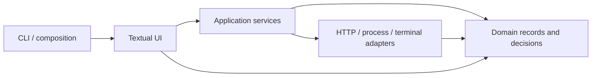
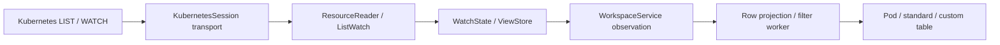
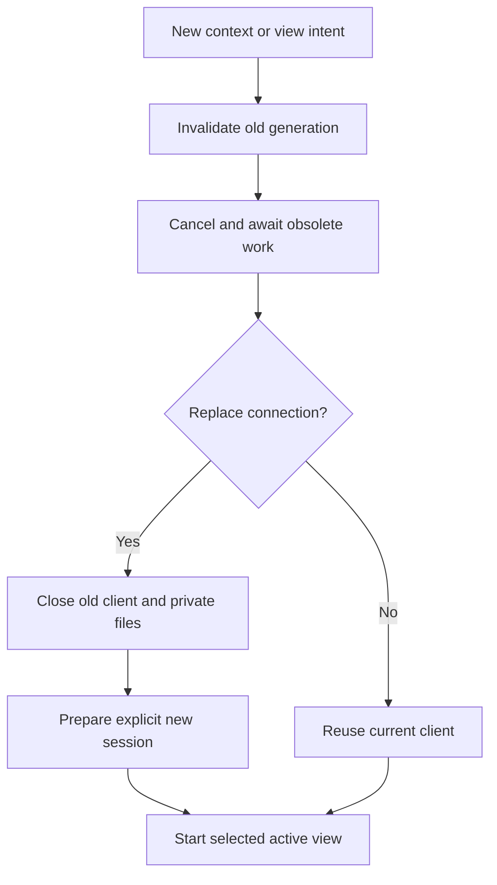

# Architecture

KubeRich is a local Python/Textual terminal client for Kubernetes. This overview
shows the implemented dependency and ownership boundaries. Use the
[decision records](adr/README.md) for individual choices and the
[quality policy](quality.md) for their verification requirements.

## Product boundary

The application talks to selected Kubernetes APIs and explicitly configured local
programs. It has no hosted backend or Textual Web interface. It does not provision
cloud clusters or replace provider login tools. K9s inspires familiar workflows;
KubeRich is an independent implementation.

The UI, pure decisions, transport adapters, and development/release tooling have
separate responsibilities. Installation does not bundle the contributor toolchain
or grant additional Kubernetes permissions.

## Chosen stack

| Responsibility | Implementation |
| --- | --- |
| Runtime | CPython 3.12–3.14 for the current package |
| Terminal UI | Pinned Textual, Rich, application-owned TCSS |
| Kubernetes transport | kubernetes-asyncio with explicit session configuration |
| Local state | Versioned YAML, validated models, platformdirs paths |
| Embedded terminal | Owned POSIX PTY and pinned, unmodified Pyte |
| Packaging | uv development resolution and Hatchling wheel/sdist backend |
| Verification | pytest, fake APIs, Pilot, real PTYs, disposable kind, installed artifacts |

See [the stack decision](adr/0001-python-terminal-stack.md) and
[packaging](adr/0031-standard-python-packaging.md). Native archives and Homebrew
have additional channel-specific build and installation contracts.

## Layers and main modules

### Domain

[Resources](../src/kuberich/domain/resources.py),
[watches](../src/kuberich/domain/watches.py),
[views](../src/kuberich/domain/views.py), and
[targets](../src/kuberich/domain/targets.py) define application records, identity,
recovery, and generation rules. Other domain modules define commands, resource
changes, logging, navigation, and validation. Domain code imports neither Textual
nor generated SDK models. Raw Kubernetes field names remain intact in records;
display and sorting use separate derived values.

### Services

[Sessions](../src/kuberich/services/sessions.py),
[workspace](../src/kuberich/services/workspace.py), and
[watches](../src/kuberich/services/watches.py) own connections and active reads.
[Projection](../src/kuberich/services/pods.py) and
[filtering](../src/kuberich/services/filtering.py) prepare rows away from the UI
loop. Commands, access policy, logs, resource changes, transfers, plugins, and
forwards use their own service owners. Services return observations/results,
not widgets, and enforce policy independently of a button or shortcut.

### Adapters

[Kubernetes](../src/kuberich/adapters/kubernetes.py) and
[credentials](../src/kuberich/adapters/credentials.py) own HTTP/TLS and helper
boundaries. [PTY](../src/kuberich/adapters/pty.py),
[terminal](../src/kuberich/adapters/terminal.py), and
[emulator](../src/kuberich/adapters/emulator.py) adapt POSIX and remote terminal
behavior. Adapters validate external data and close their resources. They do not
select another context or mutate process-global SDK defaults.

### UI

[App](../src/kuberich/ui/app.py) composes owners and routes root events.
[Chrome](../src/kuberich/ui/chrome.py),
[presentation](../src/kuberich/ui/presentation.py), and resource screens manage
layout, focus, visible rows, and selection. Nested inspection/log/container
screens keep their selected target explicit. The App still contains substantial
composition and coordination; this overview does not claim a completed controller
extraction.

### Bootstrap and local files

[CLI](../src/kuberich/cli.py), [catalogue](../src/kuberich/config/catalog.py),
[preference schema](../src/kuberich/config/schema.py), and
[store](../src/kuberich/config/store.py) select and validate local inputs.
[Diagnostics](../src/kuberich/diagnostics/redaction.py) exclude private values.
Build, test, release, and site tools live under `scripts/`, outside installed
runtime behavior. Local help/version/info/config-check require no cluster.

## Dependency direction

The composition root may construct adapters; domain decisions never depend on
widgets or SDK objects. Transport work stays asynchronous, and a UI callback
must not become a synchronous network/process wait.

## Cluster sessions and watches

Each selected connection has explicit settings, a client identity, generation,
and cleanup path. Namespace/resource changes keep that client and replace its
active view. Context replacement, retry, or interactive reauthentication drains
the previous connection's work before releasing its TLS and credential files.

Discovery selects actual served APIs and scope. Lists are complete paginated
snapshots with an opaque collection resourceVersion. WatchState applies UID-based
events; retryable interruptions resume an applied checkpoint, expiration relists,
and permission/protocol failures remain errors. A temporary failure preserves
rows marked stale rather than claiming a successful empty collection.

## Resource data flow

The store owns resource identity; projection derives typed row values and ordering.
The table applies incremental patches while preserving UID selection and viewport.
Same-name replacement objects do not inherit an old action. Generic server columns
keep their printer schema so a changed header cannot relabel an old positional
value. Hidden columns can still participate in filtering/sorting.

## Concurrency and cleanup

Every stream, parser/projection worker, subprocess, and background job has an
explicit owner. Async transport and limited cooperative batches keep the normal
UI loop available. Thread work is drained on cancellation: cancelling an await
cannot terminate an already running filesystem or decoding thread.

Subscriptions keep one pending latest observation; readers use backpressure
rather than unbounded producer queues. Display histories, caches, active jobs,
and subprocess output have separate limits. Those limits do not establish a
universal latency or resident-memory guarantee.

Dismissal is not the end of ownership. Logs, plugin jobs, forwards, transfers,
confirmed writes, and shell processes must finish their cleanup before client
files disappear. Publication checks reject old generations even after a callback
has already been scheduled. An uncertain write remains uncertain after cancel.

## Security boundaries

- Kubeconfig is trusted local configuration. Exec helpers run with user privileges,
  including to authenticate read-only requests. Operator plugins require explicit
  local definitions and invocation; neither model is an application sandbox.
- Capture context, client, resource UID/version, argv, environment, and directory
  before awaiting preparation. Delegated tools receive the prepared connection,
  not a fresh ambient current-context lookup.
- Apply shared access policy before effectful preparation. Confirmations authorize
  one exact change. Server-side UID/version conditions protect supported writes;
  exec/attach and cross-resource checks still have name/time-of-check races.
- Escape markup and terminal controls separately from credential redaction. Ordinary
  views/exports/logs redact recognized credentials and data fields; deliberate
  data reveal and trusted-editor access have their own fresh-read/disclosure rules.
- Private files and validated staging protect local drafts, credentials, and copies.
  A lost remote connection cannot guarantee termination of a server-side process
  or prove that a sent write did not apply.

## Terminal behavior

The embedded pod terminal keeps Textual active, owns a PTY/emulator, and sends
remote input before ordinary workspace bindings. Explicit local controls return
or quit. History review is local; remote control strings never reach the host.
Editors, provider login, and foreground plugins instead lease the native terminal
through explicit suspension and restoration. Those paths have different owners.

The pinned source still contains narrow private framework adapters for rendering,
cache ownership, and error handling. Their native controls and upgrade tests are
required; a pin or local cache bound is not proof of broader responsiveness.

## Decision records

Use [the ADR index](adr/README.md) for context, decisions, consequences, and source
modules. Preserve decision numbers; add or supersede a record when a verified
implementation changes its boundary. The records below also keep historical
architecture links useful.

| Decision | Record |
| --- | --- |
| Build the terminal application with Python and Textual | [0001](adr/0001-python-terminal-stack.md) |
| Keep domain decisions independent of terminal and SDK types | [0002](adr/0002-dependency-direction.md) |
| Use a separate explicit connection for each selected context | [0003](adr/0003-explicit-context-sessions.md) |
| Preserve the configured credential identity when delegating tools | [0004](adr/0004-credential-helpers-and-delegation.md) |
| Resolve API identity through discovery and version-pinned layouts | [0005](adr/0005-discovery-and-printer-schemas.md) |
| Keep collection snapshots consistent and watch versions opaque | [0006](adr/0006-list-watch-continuity.md) |
| Publish only observations belonging to the current view | [0007](adr/0007-active-view-generations.md) |
| Own external commands through one explicit process service | [0008](adr/0008-external-process-ownership.md) |
| Lease and restore the native terminal for explicit foreground tools | [0009](adr/0009-native-terminal-handoff.md) |
| Keep pod shells inside an owned embedded terminal | [0010](adr/0010-embedded-container-terminal.md) |
| Separate log delivery, retained history, and viewport following | [0011](adr/0011-single-container-log-streams.md) |
| Admit aggregate log sources through controller identity | [0012](adr/0012-controller-owned-aggregate-logs.md) |
| Bind each resource change to one reviewed conditional request | [0013](adr/0013-reviewed-conditional-writes.md) |
| Validate copied trees privately before destination publication | [0014](adr/0014-reviewed-file-transfers.md) |
| Manage forwards as connection-owned TCP sessions | [0015](adr/0015-managed-tcp-forwards.md) |
| Load and execute only explicitly configured local plugins | [0016](adr/0016-explicit-local-plugins.md) |
| Keep local preferences versioned and explicit to save | [0017](adr/0017-versioned-local-preferences.md) |
| Keep keyboard ownership and frame geometry predictable | [0018](adr/0018-focused-input-and-workspace-geometry.md) |
| Pin saved navigation to actual resource and input contracts | [0019](adr/0019-saved-resource-view-contracts.md) |
| Treat theme configuration as validated color data | [0020](adr/0020-data-only-theme-palettes.md) |
| Make release discovery optional and non-executable | [0021](adr/0021-opt-in-release-notices.md) |
| Redact ordinary views and require deliberate value disclosure | [0022](adr/0022-default-redaction-and-explicit-disclosure.md) |
| Scope rendering caches to their application and widget owners | [0023](adr/0023-widget-style-cache-ownership.md) |
| Reuse complete stylesheet parses without partial publication | [0024](adr/0024-transactional-css-parse-reuse.md) |
| Release discarded native table cache rings promptly | [0025](adr/0025-native-table-cache-retirement.md) |
| Bound projection and rendering work without changing its meaning | [0026](adr/0026-incremental-rendering-and-cooperative-work.md) |
| Separate frozen loader state from external program environments | [0027](adr/0027-frozen-runtime-delegation.md) |
| Migrate application identity without duplicating runtime packages | [0028](adr/0028-identity-and-preference-migration.md) |
| Separate tested release preparation from artifact publication | [0029](adr/0029-immutable-release-activation.md) |
| Use explicit disposable fixtures and preserve original failures | [0030](adr/0030-owned-verification-fixtures.md) |
| Build standard Python artifacts with one explicit backend | [0031](adr/0031-standard-python-packaging.md) |

## Historical source

The [previous log](internal/architecture-history/README.md) is preserved
exactly with a source commit, checksum, and per-section destination map. It contains
superseded planning and measured history, so it is not the current overview.
Acceptance history has its own pending consolidation; this change does not claim
that migration or a new platform/performance qualification is complete.
